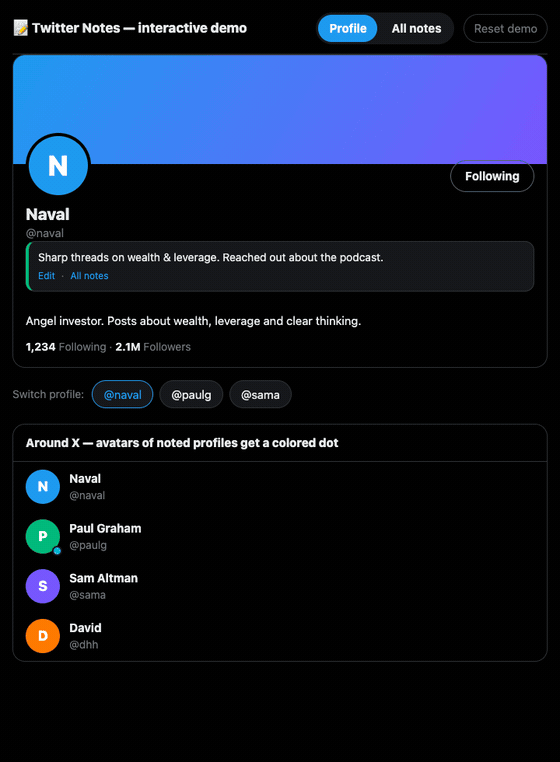

# Twitter Notes — private notes on X profiles

<!-- prettier-ignore-start -->

<!-- prettier-ignore-end -->

🧩 Chrome extension (Manifest V3) that lets you add **private notes to profiles
on X.com (Twitter)**. Data is stored locally only (`chrome.storage.local`) — there is no
server, no login, and the notes are visible only to you.

## Features ✨

- 📝 An "Add note" panel injected under the profile name on X.
- 🔁 The note shows up automatically when you return to a profile.
- 👀 A small colored dot marks the avatar of any noted profile across X; the note shows in X's native hover card.
- 🏷️ Colored profile labels (e.g. red = warning, green = OK) visible right on X.
- 🗂️ A dedicated page with all your notes: search, filter by color, edit, delete.
- 💾 Export / import all notes to a JSON file (backup).
- 🌐 Works on `x.com` and `twitter.com`.

## Demo 🎬

Try the UI without installing the extension or logging in to X: see the demo instructions in [CONTRIBUTING.md](CONTRIBUTING.md).

## Download 📥

You can download the extension from the
[Chrome Web Store](https://chromewebstore.google.com/detail/igobcjeobamlclonjpgkkjjjbmffcoma)
or build it locally from the repository (see below).

## Notes ⚠️

> [!WARNING]
> Notes live only in your browser — uninstalling the extension deletes them. Back them up
> regularly with **Export JSON** on the "All notes" page.

- A note is tied to the **profile name (@handle)**. If someone changes their `@handle`,
  the note stays under the old name (a rare case; you can move it manually). The
  `schemaVersion` field in the data leaves room for later keying by an immutable ID.
- X may change its page structure; we anchor on `data-testid` attributes, which are the
  most stable. If it breaks, the panel simply won't show — your notes are still available
  on the "All notes" page.

## Privacy Policy 🔒

The extension stores everything locally in your browser and sends nothing anywhere — no
servers, no analytics, no third parties. See [privacy-policy.md](privacy-policy.md) for the
full statement.

## Contributing

Building the extension, the demo, scripts and project structure: see [CONTRIBUTING.md](CONTRIBUTING.md).

## License

[The MIT License](https://piecioshka.mit-license.org) @ 2026
